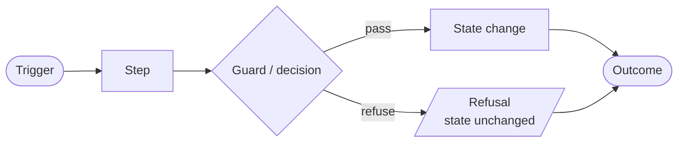
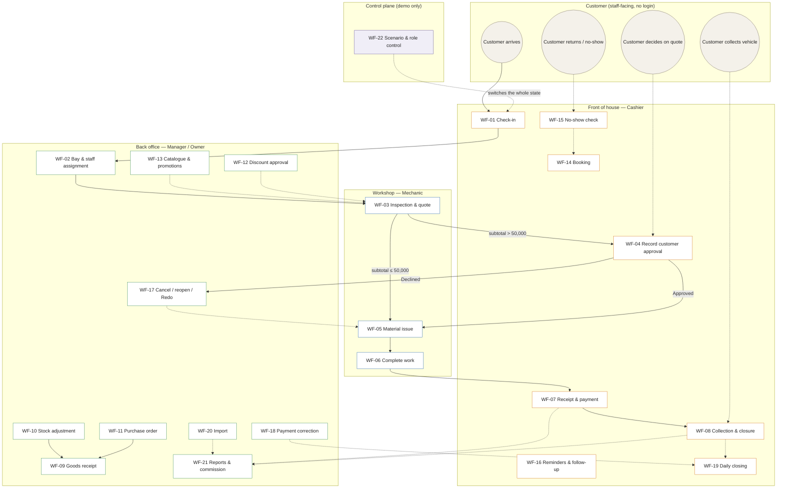
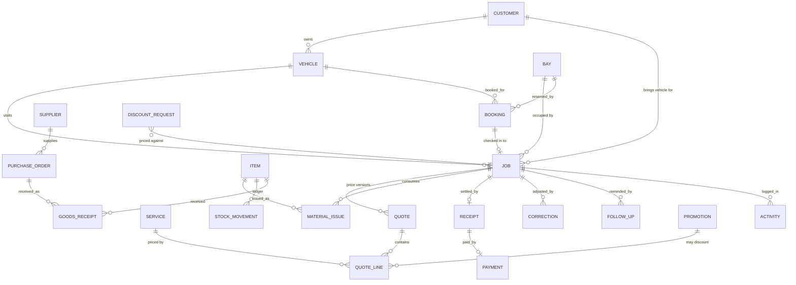

# Process Design — Detailed System Workflows

**System:** Dolphin AutoTrack — internal workshop management system
**Artefact type:** Process design / workflow specification
**Status:** Describes the working prototype in this repository
**Audience:** CSC213 Systems Analysis and Design — Group 4 High Five

Every workflow below is a description of the system as it is actually built in
this repository. Where a step is a *guard* (a refusal with a reason) it is
listed as a guard, not as a step. All people, vehicles, prices and records are
fictional demo data; no real transaction, message or purchase occurs anywhere.

---

## 0. Document control

| Item | Value |
|---|---|
| Source of truth for behaviour | `reference/01_Codex_Build_Guide.md` (the written specification) |
| Source of truth for data | `data/02_Dummy_Data.json` (16 scenario snapshots + fixtures) |
| Source of truth for implementation | `js/rules.js`, `js/actions.js`, `js/act-*.js`, `js/views/s01–s20.js` |
| Related documents | `README.md` (what is in the box), `docs/VIEW_CONTRACT.md` (how to extend), `docs/TEST_RESULTS.md` (evidence) |
| Change control | Any edit to `js/rules.js` or the build guide must be reflected here in the same commit. |

---

## 1. Purpose and scope

### 1.1 Purpose

This document specifies **how work moves through Dolphin AutoTrack**: what
triggers a process, which role does what, which decision points exist, what
the system refuses to do, and what state changes as a result. It is the
process-design companion to the functional description in the README and the
technical contract in `docs/VIEW_CONTRACT.md`.

### 1.2 In scope

* All 20 staff screens (S01–S20) and the processes they host.
* The **one shared in-memory state** and how a screen reads and writes it.
* The **role model** (Owner / Manager / Cashier / Mechanic) and the
  presentation-only demo controls.
* Every business guard the prototype enforces — approval thresholds, stock
  ceilings, settlement rules, closure preconditions, rounding.
* The 16 scenario presets and how they relate to the workflows.

### 1.3 Out of scope

These are deliberately **not** implemented and therefore have no workflow:

| Excluded | Why |
|---|---|
| Authentication, login, 30-minute logout | The prototype is staff-facing with a labelled role preview, not a security boundary. |
| Database, server API, backend | Frontend-only prototype: one in-memory state, no persistence. |
| Real payment gateway, QR, bank details | Payments are simulated. |
| Messaging / Viber / Messenger sending | Follow-ups record an outcome; nothing is sent. |
| Background scheduler, no-show timer, backup service | Time-based rules run on an explicit demo action against a fixed clock. |
| Tax invoice, tax percentage | The document produced is a *Receipt*, not a tax invoice. |
| Real commission rate, overhead, net profit | The commission rule in the fixture is explicitly illustrative. |

### 1.4 Prototype constraints that shape the workflow design

| Constraint | Effect on the workflows |
|---|---|
| Frontend only, one in-memory state | Every "save" mutates a plain object; there is no transaction, so all linked fields are updated together in one handler to avoid impossible states. |
| No storage | "Cancel" cannot be undone by reloading; **Reset scenario** / **Reset all** are the only reverts. |
| Fixed demo clock | 28 Oct 2026 10:00 Asia/Yangon. All date logic reads `Store.now()`, never the machine clock — this is what makes no-show and reminder boundaries testable. |
| Role selector is presentation, not auth | Role switching is modelled and guarded in the UI; it is explicitly *not* a security control. |
| No external calls | Every process terminates inside the browser. |

---

## 2. How to read this document

### 2.1 Identifier scheme

| Prefix | Meaning | Example |
|---|---|---|
| **WF-nn** | A workflow (a business process with a trigger and an outcome) | WF-03 Inspection & quotation |
| **PD-nn** | A cross-cutting rule that more than one workflow depends on | PD-02 Approval threshold |
| **S-nn** | A screen (S01–S20) | S07 |
| **P-nn** | A scenario preset (P01–P16) | P05 |

### 2.2 Conventions

* **Trigger** — the event that starts the workflow.
* **Precondition** — what must already be true; if it is not, the workflow never starts.
* **Guard** — a check that refuses the action and states the reason. Guards never mutate state.
* **State change** — the fields written by the step.
* **Activity log** — every state-changing step appends to `state.activity` with actor, demo time and reason.
* *MMK* — Myanmar Kyat. All money is integer MMK.

### 2.3 Diagram legend



Solid box = an activity a user performs. Rounded box = a start/end event.
Diamond = a decision. Slanted box = a refusal path. The red edge in the master
map is the control plane (demo controls) rather than a business process.

---

## 3. System context

### 3.1 What the system is for

Dolphin AutoTrack runs the back office of a vehicle workshop. One **job**
(a vehicle visit) is the spine of the system. Everything else hangs off it:
the quote that prices it, the approval that authorises it, the materials
consumed from stock, the receipt that settles it, the collection that hands
the vehicle back, and the closure that archives it. In parallel the workshop
runs a **stock ledger** (receipts, issues, adjustments), a **booking diary**
(reservations against bays), a **catalogue** (services, promotions, discounts),
a **daily cash closing**, **imports**, and **reporting**.

The single most important design decision in the whole system is that
**work, approval, payment, collection and closure are five independent
statuses**. Completing the repair does not settle the bill, settling the bill
does not mean the car left, and closing the job is a third, later act.

### 3.2 Actors and roles

All four roles are **internal staff**. There is no customer login and no
customer portal; a customer's decisions are recorded *by staff on their
behalf*.

| Role | Fixture user | Primary work | Screens available |
|---|---|---|---|
| **Owner** | Owner Demo | Everything a Manager can do, plus discount approval above 10 %, demo settings and bay configuration | S01–S20 (all) |
| **Manager** | Manager Demo | Bay/staff assignment, cancel/reopen/Redo, discount approval ≤ 10 %, corrections, closing, reports | S01–S19 (all but S20) |
| **Cashier** | Cashier Demo | Check-in, customer decisions, receipts, payment, collection, closing, discount *requests* | S01–S06, S08, S12–S15, S17 |
| **Mechanic** | Aung (Demo), Min (Demo) | Inspect, quote, progress, issue materials — **only on jobs assigned to them** | S01, S05, S06, S07, S08 (read-only), S09 |

The two mechanic demo users exist so that **assigned-job visibility** can be
demonstrated: Aung cannot see Min's `JOB-2026-0006`.

**Per-screen access registry** (`js/app.js:73–94`). A screen not listed in the
registry is allowed for every role.

| Screen | Title | Owner | Manager | Cashier | Mechanic |
|---|---|:--:|:--:|:--:|:--:|
| S01 | Dashboard | ✔ | ✔ | ✔ | ✔ |
| S02 | Customers | ✔ | ✔ | ✔ | — |
| S03 | Register vehicle | ✔ | ✔ | ✔ | — |
| S04 | Vehicle check-in | ✔ | ✔ | ✔ | — |
| S05 | Bay board | ✔ | ✔ | ✔ | ✔ |
| S06 | Jobs | ✔ | ✔ | ✔ | ✔ |
| S07 | Inspection | ✔ | ✔ | — | ✔ |
| S08 | Customer approval | ✔ | ✔ | ✔ | ✔ *(view only)* |
| S09 | Job materials | ✔ | ✔ | — | ✔ |
| S10 | Inventory | ✔ | ✔ | — | — |
| S11 | Receive stock | ✔ | ✔ | — | — |
| S12 | Receipts | ✔ | ✔ | ✔ | — |
| S13 | Reminders | ✔ | ✔ | ✔ | — |
| S14 | Bookings | ✔ | ✔ | ✔ | — |
| S15 | Catalogue | ✔ | ✔ | ✔ *(discount requests tab)* | — |
| S16 | Stock adjustment | ✔ | ✔ | — | — |
| S17 | Daily closing | ✔ | ✔ | ✔ | — |
| S18 | Import preview | ✔ | ✔ | — | — |
| S19 | Reports | ✔ | ✔ | — | — |
| S20 | Demo settings | ✔ | — | — | — |

**Navigation groups.** Owner and Manager see Dashboard · Customers · Jobs · Bay
board · Bookings · Inventory · Catalogue · Receipts · Reports · **More** ·
(Owner only) Settings. **More** holds Reminders · Daily closing · Corrections ·
Import preview. The Cashier sees Dashboard · Customers · Jobs · Bay board ·
Bookings · Receipts · Discount request · Reminders · Daily closing. The
Mechanic sees My jobs · Current job · Inspection · Approval · Materials ·
Progress — all of which are S06, S07, S08 and S09 with different parameters.

**Landing screen.** `App.landing()` returns **S06 (My jobs)** for a Mechanic
and **S01 (Dashboard)** for everyone else. On a first load the screen is the
active scenario's `startScreen` instead — P01 opens on **S02**.

> When a role reaches a screen it may not use, the shell shows an access
> notice and returns the user to that role's landing screen. The access check
> runs **before** the unsaved-form guard, so a denied route never triggers a
> discard prompt.


### 3.3 Process inventory

| ID | Process | Trigger | Primary owner | Screens |
|---|---|---|---|---|
| WF-01 | Vehicle check-in | Vehicle arrives | Cashier | S02 → S04 → S06 |
| WF-02 | Bay & staff assignment | Job needs a bay | Manager | S05 → S06 |
| WF-03 | Inspection & quotation | Work starts | Mechanic | S06 → S07 |
| WF-04 | Customer approval | Quote above threshold | Cashier | S08 |
| WF-05 | Material issue | Work needs parts | Mechanic | S09 |
| WF-06 | Work completion & bay release | Checklist complete | Mechanic | S06 |
| WF-07 | Receipt, payment & change | Work complete | Cashier | S12 |
| WF-08 | Collection & job closure | Bill settled | Cashier | S12 |
| WF-09 | Goods receipt (stock in) | Delivery arrives | Manager | S11 → S10 |
| WF-10 | Stock adjustment & disposition | Count / damage / return | Manager | S16 |
| WF-11 | Purchase order | Stock needs replenishing | Manager | S10 |
| WF-12 | Discount request & approval | Cashier wants a discount | Cashier → Manager/Owner | S15 |
| WF-13 | Catalogue & promotions maintenance | Price list changes | Owner/Manager | S15 |
| WF-14 | Booking & bay reservation | Customer books | Cashier → Manager | S14 |
| WF-15 | No-show handling | Booking start + 30 min passes | Cashier/Manager | S14 |
| WF-16 | Reminders & follow-up | Due date passes | Cashier | S13 |
| WF-17 | Cancel, reopen & Redo | Job must be unwound | Manager | S06 |
| WF-18 | Payment correction | A charge or method is wrong | Manager/Owner | S17 |
| WF-19 | Daily cash closing | End of workshop day | Cashier | S17 |
| WF-20 | Staged data import | Records need loading | Manager/Owner | S18 |
| WF-21 | Reporting & commission | Period reviewed | Manager/Owner | S19 |
| WF-22 | Demo scenario & role control | Presentation setup | Any (demo only) | Topbar |

### 3.4 Master process map



**Read the map as:** the horizontal spine (WF-01 → WF-08) is the job lifecycle
that every revenue event flows through. The vertical branch below it (WF-09 →
WF-21) is the back office that feeds and audits that spine. The red dashed
line at the bottom is the demo control plane, which is not a business process
at all — it exists only to put the prototype into a reproducible state.

---

## 4. Shared data model and state lifecycle

### 4.1 One state, one snapshot

Every screen reads and writes **the same object**, `Store.state`. There is no
per-screen copy and no persistence layer.

```
Store.state
├── demoNow, activeUserId, language, selectedJobId, selectedVehicleId
├── users[5]              roles and demo identities
├── customers[]  vehicles[]  services[]  items[]  suppliers[]  bays[]
├── jobs[]                the spine
│   └── quotes[]          versioned price versions per job
├── promotions[]  discountRequests[]
├── bookings[]  purchaseOrders[]  goodsReceipts[]  stockMovements[]
├── receipts[]  payments[]  corrections[]  cashClosings[]
├── followUps[]  importBatches[]  commissionRule  commissionPayouts[]
├── activity[]            in-memory audit trail
└── counters              ID allocation (job, receipt, payment, vehicle, …)
```

**Lifecycle of the state object:**

| Event | Effect on state | Implemented by |
|---|---|---|
| Page load | `Store.init()` deep-copies scenario **P01** into `Store.state` | `js/store.js:23` |
| Scenario switch | The *entire* state is replaced by a deep copy of the preset. Presets are never merged; seeded movements, payments and receipts are never replayed. | `Store.loadScenario()` |
| Reset scenario | The current preset's initial state is deep-copied back in. | `Store.resetScenario()` |
| Reset all | P01 + Cashier role. | `Store.resetAll()` |
| Any save | Mutates `Store.state` in place, appends to `state.activity`, then `App.render()` redraws every view. | `js/actions.js`, `js/act-*.js` |

Because a preset is a *complete snapshot*, `items[].onHand` in a preset is
already the opening balance. The prototype never "replays" the movements that
led to that balance — that is why switching from P03 (5 parts) to P11 (5
parts) does not double-count anything.

### 4.2 The five independent job statuses

This is the structural rule that most of the workflows exist to enforce.

| Field | Values | Set by | Cleared/advanced by |
|---|---|---|---|
| `workStatus` | Checked in → Diagnose/Quote → Approved → In Progress → *(Waiting for Parts)* → Completed | WF-01, WF-03, WF-05, WF-06 | WF-06 |
| `approvalStatus` | Not required · Pending · Approved · Declined | WF-03 (compute), WF-04 (decide) | WF-04 |
| `paymentStatus` | Unpaid · Paid · No charge · Review required | WF-07 | WF-07, WF-18 |
| `collectionStatus` | Not collected · Collected | WF-08 | WF-08 |
| `lifecycleStatus` | Open · Closed · Cancelled | WF-17 (cancel), WF-08 (close) | WF-08, WF-17 |

Two consequences are load-bearing and are asserted by the test suites:

1. **Completing the repair releases the bay immediately**, while the job may
   still be `Unpaid` and `Not collected`. A completed-but-unpaid vehicle
   appears in the *completed/uncollected queue* on the bay board — it does
   **not** occupy a bay card.
2. **`approvalStatus: Not required` is not "Approved".** It means the
   pre-discount repair subtotal was at or below 50,000 MMK so no customer
   decision was needed. The prototype never claims a customer approved work
   that did not require approval.

### 4.3 Entity relationships



**Snapshot vs live reference.** A receipt stores its *own copy* of the priced
lines (`receipt.lines`), so editing a catalogue price or a customer profile
afterwards never rewrites history. Likewise a material issue stores the
purchase-cost snapshot used at issue time. This is the mechanism behind the
rule *"lock paid price lines; use separate reasoned corrections"*.

### 4.4 The demo clock

`state.demoNow` is a fixed ISO instant, `2026-10-28T10:00:00+06:30`
(Asia/Yangon). Every date-sensitive rule reads it through `Store.now()`:

* **Report date basis** — the workshop local date of `demoNow`, never UTC and
  never the machine date.
* **Reminder eligibility** — `completedAt` older than three days.
* **No-show** — booking start + 30 minutes.
* **Next-service due** — an explicitly stored due date, or latest known
  mileage ≥ due mileage. Mileage is never inferred from elapsed time.

Because the clock is fixed, boundary behaviour is testable and reproducible:
"exactly three days" is *not yet* eligible, one minute later is.

---

## 5. Detailed workflows

### WF-01 — Vehicle check-in

**Trigger** A vehicle arrives at the workshop · **Owner** Cashier (Mechanic: assigned-job context only)
**Screens** S02 → S04 → S06 · **Records** `jobs`, `vehicles`, `activity`

| # | Step | Actor | System behaviour | State change |
|---|---|---|---|---|
| 1 | Search for the customer or plate on S02 | Cashier | Case-insensitive match on customer name or plate, trimmed and case-normalised without stripping meaningful plate characters | — |
| 2 | Open the vehicle, choose **New check-in** | Cashier | Navigates to S04 with the vehicle pre-selected | `selectedVehicleId` |
| 3 | Enter mileage | Cashier | Required, non-negative. Empty is **not** zero. Must not be below the latest recorded visit unless a Manager confirms a reasoned correction | — |
| 4 | Select vehicle size S/M/L | Cashier | Explicit choice. Size is never inferred from a sedan/SUV label | — |
| 5 | Enter service, damage, fuel level, belongings | Cashier | All recorded on the visit | — |
| 6 | Optional photo tile | Cashier | A local supplied placeholder only. There is no upload service | — |
| 7 | **Create demo job** | Cashier | Snapshots the current catalogue price context into the job, allocates the next job id from `counters.nextJob`, and sets `workStatus='Checked in'` | new `job`, `activity` |
| 8 | Land on the job card or the bay board | System | The new job is visible in both immediately | — |

**Guards and refusals**

| Guard | Result |
|---|---|
| The vehicle already has an open visit | Refused. The existing job is shown together with a Manager review notice. No second open job is created. |
| Mileage empty | Refused — "empty mileage is not zero". |
| Mileage below the latest recorded visit | Refused unless a Manager confirms a reasoned demo correction. |
| Vehicle archived | Cannot be checked in. |
| Duplicate submission | The job id counter advances once; a repeated submit does not create a second job. |

---

### WF-02 — Bay and staff assignment

**Trigger** A checked-in job needs a bay and a mechanic · **Owner** Manager or Owner
**Screens** S05 → S06 · **Records** `jobs`, `bays`, `activity`

| # | Step | Actor | System behaviour | State change |
|---|---|---|---|---|
| 1 | Open the bay board (S05) | Manager | Shows three bay cards. A bay is **Available** when it is enabled and has no occupant; each card names the assigned job, vehicle and mechanic | — |
| 2 | Choose **Assign** | Manager | Opens a modal with three inputs: an eligible job, a free bay, one or more mechanics | — |
| 3 | Pick the job | Manager | Only *eligible* jobs are listed: `lifecycleStatus='Open'` and `workStatus` not Completed/Cancelled | — |
| 4 | Pick the bay | Manager | Only enabled bays with no active occupant are offered | — |
| 5 | Pick one or more mechanics | Manager | A Manager may assign several mechanics to one job | — |
| 6 | Confirm | Manager | Writes the assignment and logs it | `job.bayId`, `job.assignedStaffIds`, `activity` |

**Guards and refusals**

| Guard | Result |
|---|---|
| Bay already has an active job | Refused — one active vehicle per bay. |
| Bay disabled in S20 | Refused — an inactive bay cannot be assigned. |
| Booking reserved for that bay at that time | Refused with a **replan** reason for the Manager. The system never silently frees another job's bay. |
| No mechanic selected | Refused. |
| Cashier opens the board | The board is visible but assignment controls are **hidden**, not disabled. |
| Mechanic opens the board | Only that mechanic's own assignments are shown. |

> **Booking reservation and physical occupancy are separate.** A future booking
> does not make a repair bay look occupied. A reservation may still prevent an
> arrival from being assigned, which is why the conflict is reported as a
> replan decision rather than a silent swap.

---

### WF-03 — Inspection and quotation

**Trigger** Work begins on an assigned job · **Owner** Mechanic (Owner/Manager may also do it; Cashier may not edit repair scope)
**Screens** S06 → S07 → S08 · **Records** `jobs[].quotes`, `activity`

| # | Step | Actor | System behaviour | State change |
|---|---|---|---|---|
| 1 | **Start inspection** on the job card | Mechanic | Job moves to `workStatus='Diagnose/Quote'`; a new draft quote version is opened | `job.workStatus` |
| 2 | Enter inspection notes | Mechanic | Free text on the quote | draft quote |
| 3 | Add service lines | Mechanic | Labour lines carry a price snapshot taken from the catalogue **as it was when the job was created** | draft quote lines |
| 4 | Add material lines | Mechanic | Each line records its source: **Shop** (deductible from stock) or **Customer** (a descriptive zero shop-charge line with no stock effect). Customer-supplied material is never shown as a shop sale | draft quote lines |
| 5 | Add/remove draft lines | Mechanic | Permitted freely **before** submission | draft quote lines |
| 6 | **Save draft** | Mechanic | The unsaved draft is preserved across a redraw | `Store.draft` |
| 7 | **Cancel** | Mechanic | Discards the draft and leaves the previously saved version untouched | draft cleared |
| 8 | **Submit quote** | Mechanic | Computes the approval basis, decides Pending vs Not required, and **freezes** the version | `quotes[]`, `job.activeQuoteVersion`, `job.approvalStatus` |
| 9 | **Start work** on the job card | Mechanic | Validates the assignment and the authorisation (`Rules.canStartWork`). Commits the approved quote's labour lines to the job and moves it to `workStatus='In Progress'` | `job.committedServiceLines`, `job.workStatus` |

**How the approval basis is computed**

```
approval basis = Σ (quantity × unitPrice)  over every line flagged `repair`
                 = repair labour + related shop parts/oil
                 measured BEFORE discount and BEFORE rounding
                 EXCLUDING unrelated wash services
```

| Basis | Result | `approvalStatus` |
|---|---|---|
| ≤ 50,000 MMK | No customer decision needed | `Not required` |
| > 50,000 MMK | A customer decision is required | `Pending` |

**Guards and refusals**

| Guard | Result |
|---|---|
| Material quantity in a quote | Accepted, but **stock is not touched**. Quoting never deducts. |
| A frozen version | Cannot be edited. A change after authorisation creates a **new version**; the approved one is never rewritten. |
| Extra work | Adds a new draft version with the prior scope displayed alongside. Extra work **always** needs its own approval, even at 1,000 MMK. |
| Parts already issued under v1 | Stay issued. Accepting v2 does **not** re-issue them. |
| Cancelled job | Cannot be quoted. |

---

### WF-04 — Record the customer's decision

**Trigger** A quote version is `Pending` · **Owner** Cashier (Owner/Manager may also record it; **Mechanic cannot**)
**Screens** S08 · **Records** `jobs[].quotes[].status`, `job.approvalStatus`, `activity`

| # | Step | Actor | System behaviour | State change |
|---|---|---|---|---|
| 1 | Open the approval screen | Cashier | Shows the exact quote version, the old and revised totals, and what changed in scope | — |
| 2 | Choose **Approved** or **Declined** | Cashier | Required | — |
| 3 | Choose the channel | Cashier | Phone · Viber · Messenger · In person. Required | — |
| 4 | Add a contact note | Cashier | Free text. No message is actually sent to anyone | — |
| 5 | Tick the confirmation | Cashier | Required | — |
| 6 | Save the decision | Cashier | The decision is retained **against its quote version**; the timestamp and recorder come from the demo state | `quote.status`, `quote.decision`, `job.approvalStatus`, `activity` |

**Guards and refusals**

| Guard | Result |
|---|---|
| Decision or channel missing | Refused — field-specific errors, nothing saved. |
| Version is superseded | Refused — a superseded version cannot be approved as the current scope. |
| Initial quote declined | Starting work is blocked. A new proposal (a new version) is required. |
| Extra-work version declined | The earlier approved scope stays visible and usable **once the addition is explicitly withdrawn** (Owner or Manager only). The declined quote record is retained. |
| Mechanic attempts to record the decision | Not offered. A mechanic sees a read-only summary instead. |
| A new proposal after a decline | Requires another version and another decision. |

---

### WF-05 — Material issue (stock out)

**Trigger** Work needs a shop part, oil or consumable · **Owner** Mechanic on an assigned job (Owner/Manager may also issue)
**Screens** S09 · **Records** `jobs[].materialIssues`, `items[].onHand`, `stockMovements`, `activity`

| # | Step | Actor | System behaviour | State change |
|---|---|---|---|---|
| 1 | Open job materials (S09) | Mechanic | Lists the authorised material lines of the approved quote with availability, unit, quantity already issued and quantity still pending | — |
| 2 | Choose the line and quantity | Mechanic | Quantity must be positive and **not more than the remaining approved quantity**. Pieces and bottles are whole numbers; litres may be fractional | — |
| 3 | **Add to job** | Mechanic | Deducts stock **once**, appends one material issue and one stock movement, and disables the line if it is now fully issued | `items[].onHand`, `materialIssues[]`, `stockMovements[]`, `activity` |

**Guards and refusals**

| Guard | Result |
|---|---|
| The line's quote version is not `Approved` | Refused. Approval is checked **per quote line**, not by a global green badge. |
| Job already paid | Refused — the unpaid lock. |
| Mechanic not assigned to the job | Refused — `Store.visibleJobs()` scoping. |
| Quantity 0, negative, or a disallowed fraction | Refused. |
| Quantity exceeds the remaining approved quantity | Refused. |
| **Stock on hand < required** | Refused. **No issue, no movement.** The job shows **Waiting for Parts**. |
| Line already fully issued | The line is disabled; a repeated click leaves stock unchanged (5 → 4 stays 4). |

> **Receiving stock does not quietly satisfy a waiting job.** In P05 the
> Manager receives five pieces (stock 5 → 10) and the six-piece requirement is
> *still* pending until the Mechanic explicitly retries the issue
> (stock 10 → 4).

---

### WF-06 — Complete the work and release the bay

**Trigger** The mechanic believes the repair is finished · **Owner** Mechanic
**Screens** S06 · **Records** `jobs[].workStatus`, `completedAt`, `bayId`, `activity`

| # | Step | Actor | System behaviour | State change |
|---|---|---|---|---|
| 1 | Tick the required checklist | Mechanic | Toggles affect only the selected job | `job.requiredChecklist` |
| 2 | **Mark complete** | Mechanic | Writes the completion fields **together** | `workStatus='Completed'`, `completedAt`, `bayId` cleared, `activity` |

**Guards and refusals**

| Guard | Result |
|---|---|
| No checklist exists on the job | Refused — "Add a required checklist before completing." |
| A checklist item is not done | Refused — the item text is named in the reason. |
| An unresolved shortage remains | Refused — "Shortage unresolved: `<item>` (need *n*, on hand *m*)". |
| An extra-work version is still `Pending` | Refused — "Extra work is still waiting for a customer decision." |
| An extra-work version was declined but not withdrawn | Refused — "Withdraw the declined extra work before completing the original scope." |

> **The bay is released at the moment of completion** — even though
> `paymentStatus` is still `Unpaid` and `collectionStatus` is still
> `Not collected`. The completed vehicle moves to the completed/uncollected
> queue on S05; it does not occupy a bay card.
>
> `Waiting for Parts`, by contrast, **keeps** the bay occupied until a
> Manager reassigns it.

---

### WF-07 — Draft receipt, payment and change

**Trigger** The work is complete and the vehicle is ready to be paid for · **Owner** Cashier (Mechanic: no access)
**Screens** S12 · **Records** `receipts`, `payments`, `jobs[].paymentStatus`, `activity`

| # | Step | Actor | System behaviour | State change |
|---|---|---|---|---|
| 1 | Open the receipt list (S12) | Cashier | Two filters: unpaid previews and issued receipts | — |
| 2 | Open the job | Cashier | Builds an **unnumbered draft receipt** from the job's own snapshots — never from today's catalogue | draft |
| 3 | Review the itemisation | Cashier | Regular charge, discounts, parts/oil, rounding adjustment, final payable | — |
| 4 | Choose the payment method | Cashier | Cash · KBZPay · WavePay | — |
| 5 | Enter cash tendered (cash only) | Cashier | Must cover the whole payable. Applied = payable; change = tendered − payable | — |
| 6 | Enter reference + tick **Verified (demo)** (wallet only) | Cashier | Both required. No wallet credentials are requested and no payment link is opened | — |
| 7 | **Record payment** | Cashier | Creates exactly **one receipt** and **one payment**, locks the financial lines, and marks the job paid | `receipts[]`, `payments[]`, `paymentStatus='Paid'`, `activity` |

**What the receipt is built from**

```
receipt lines = committed service lines          (authorised labour/zero-charge lines)
              + issued shop material lines       (quantity − returned quantity)
              + Redo Manager-set price           (Redo jobs only, added once)

subtotal = Σ quantity × unitPrice
discount = Σ line discounts
net      = subtotal − discount
payable  = round(net) to nearest 100 MMK, half up      ← one rounding, at the end
```

**Guards and refusals**

| Guard | Result |
|---|---|
| Unapproved quote line | Never billed. |
| Shop part not yet issued | Never billed. |
| Declined addition | Never billed. |
| Cash tendered < payable | Refused — a part payment is not accepted. For a 60,000 bill, 20,000 is rejected and no payment is posted. |
| Wallet without a reference, or without the verified tick | Refused. |
| Payment already posted (double click, or returning to the paid page) | No second receipt and no second payment. The receipt keeps its number. |
| Zero-charge Redo | Settled with **"Settle as no charge"** → a zero-total receipt and no fabricated cash transfer. `paymentStatus='No charge'`. |
| Reprint | Same number, labelled **COPY**. |

**Rounding rule (PD-04)** — the receipt total is rounded **once**, at the end, to
the nearest 100 MMK, half upward: `floor((total + 50) / 100) * 100`.
60,149 → 60,100 (−49). 60,150 → 60,200 (+50). Individual lines are **not**
rounded. A percentage-derived MMK amount is rounded half up to a whole MMK
*before* the final receipt rounding.

---

### WF-08 — Collection and job closure

**Trigger** The bill is settled · **Owner** Cashier
**Screens** S12 · **Records** `jobs[].collectionStatus`, `collectedAt`, `lifecycleStatus`, `closedAt`, `nextServiceDue*`

| # | Step | Actor | System behaviour | State change |
|---|---|---|---|---|
| 1 | **Mark collected** | Cashier | Records the vehicle handover. Enabled only when the job is settled | `collectionStatus='Collected'`, `collectedAt` |
| 2 | Optionally enter the next-service date and/or mileage | Cashier | Explicit sample values only. No automatic service interval is invented | `nextServiceDueDate`, `nextServiceDueMileageKm` |
| 3 | **Close job** | Cashier | The job moves into history | `lifecycleStatus='Closed'`, `closedAt`, `activity` |

**Guards and refusals**

| Guard | Result |
|---|---|
| Collection attempted before full settlement | Refused. `Paid` **and** `No charge` both satisfy it; the *effective balance* must be zero. |
| Close attempted while the work is not completed | Refused — "Work is not completed." |
| Close attempted while the effective balance ≠ 0 | Refused — "The effective balance is not settled." A correction that leaves a nonzero balance sets `paymentStatus='Review required'` and blocks closure. |
| Close attempted before collection | Refused — "The vehicle has not been collected." |
| "Collected" | Means the **vehicle** was handed over. It does not mean the receipt was collected. |

---

### WF-09 — Receive stock (goods receipt)

**Trigger** A delivery arrives from a supplier · **Owner** Manager or Owner
**Screens** S11 → S10 · **Records** `goodsReceipts`, `items[].onHand`, `items[].latestPurchaseCostMMK`, `stockMovements`, `activity`

| # | Step | Actor | System behaviour | State change |
|---|---|---|---|---|
| 1 | Open Receive stock (S11) | Manager | — | — |
| 2 | Enter supplier, delivery reference, date, item, quantity, unit, purchase cost | Manager | All required; quantity must be positive and the cost non-negative | — |
| 3 | Review the preview | Manager | Shows the current balance and the resulting balance | — |
| 4 | **Record receipt** | Manager | Appends the goods receipt, appends a stock movement, updates on-hand and the latest purchase cost | `goodsReceipts[]`, `stockMovements[]`, `items[]`, `activity` |
| 5 | Return to inventory | System | The balance and the movement history both show the new figure | — |

**Worked example (P11)** — Brake part, 5 pieces at 12,000 MMK = 60,000 MMK
from SUP-01, reference `DEMO-DEL-028`: stock **5 → 10**.

**Guards and refusals**

| Guard | Result |
|---|---|
| The same supplier + reference + item is received again | Refused — duplicate receipts are not allowed. |
| Quantity ≤ 0, or a negative cost | Refused. |
| Historic issued costs | Unchanged. An issue keeps the cost snapshot it was made with. |
| A waiting job | Still pending. Receiving does **not** deduct stock for it. |

---

### WF-10 — Stock adjustment and disposition

**Trigger** A physical count, a damaged item, an opened consumable or a part coming back from a cancelled job · **Owner** Manager or Owner
**Screens** S16 · **Records** `stockMovements`, `items[].onHand`, `jobs[].materialIssues`, `activity`

**Movement types:** count adjustment · consumable opened · write-off ·
supplier return · recoverable job return.

| # | Step | Actor | System behaviour | State change |
|---|---|---|---|---|
| 1 | Open Adjust (S16) | Manager | — | — |
| 2 | Choose item, movement type, quantity, unit and reason | Manager | Item, unit, a valid quantity, a reason, an actor and a timestamp are all required | — |
| 3 | Review the before/after preview | Manager | Shows the current balance and the resulting balance | — |
| 4 | **Save** | Manager | Appends a movement. **Older movements are never rewritten** | `stockMovements[]`, `items[].onHand`, `activity` |
| 5 | **Cancel** | Manager | Leaves stock unchanged | — |

**Guards and refusals**

| Guard | Result |
|---|---|
| Write-off or supplier return larger than the quantity on hand | Refused — stock may only be taken from what is actually on hand. |
| Recoverable job return without the original issue | Refused — the return must reference the original issue. |
| Recoverable return larger than the unreturned quantity of that issue | Refused. The part can return **once** (P04: 4 → 5). |
| A consumed/unusable already-issued item | Recorded as a **disposition with zero additional stock delta** — not a second deduction. |
| A consumable opened | One manual deduction only. No automatic duplicate. |
| A fractional quantity on a whole-number item | Refused. |

---

### WF-11 — Purchase order

**Trigger** Stock needs replenishing · **Owner** Manager or Owner
**Screens** S10 (Purchase orders tab) → S11 · **Records** `purchaseOrders`, `suppliers`, `activity`

| # | Step | Actor | System behaviour | State change |
|---|---|---|---|---|
| 1 | Open the Purchase orders tab (S10) | Manager | — | — |
| 2 | Create the order | Manager | Sample order: 5 brake pieces at 12,000 = 60,000 MMK from SUP-01, reference `DEMO-PO-028` | `purchaseOrders[]` |
| 3 | Order is `Ordered` | System | **Stock does not increase.** A purchase order alone never moves stock | — |
| 4 | **Receive against order** → S11 | Manager | Runs WF-09. Success sets the order to `Received`, or `Partial` when a smaller quantity is demonstrated | `purchaseOrders[]` status |

**Guards and refusals**

| Guard | Result |
|---|---|
| Supplier archived | Cannot be selected for a new order. Records that already name it keep the name. |
| Receiving | The physical receipt in WF-09 is what changes the balance. |

> No real supplier message is sent and no purchase is placed. The order is a
> sample record.

---

### WF-12 — Manual discount request and approval

**Trigger** A discount is needed on an unpaid quote · **Owner** Cashier requests → Manager or Owner approves
**Screens** S15 (Discount requests tab) · **Records** `discountRequests`, `jobs[].quotes`, `activity`

| # | Step | Actor | System behaviour | State change |
|---|---|---|---|---|
| 1 | Open Discount requests (S15) | Cashier | — | — |
| 2 | Pick an unpaid quote and enter a percentage | Cashier | The request is stored with its requester, percentage and reason | `discountRequests[]` |
| 3 | Approve | Manager / Owner | The request is stored with its approver and reason | `discountRequests[].status`, `activity` |
| 4 | Applied to the quote | System | If the quote was already authorised, a **new quote version** is created for review. The authorised price is never edited silently | new quote version |

**Authority limits**

| Percentage | Who may approve |
|---|---|
| ≤ 10 % | Manager **or** Owner |
| > 10 % | Owner only — a Manager cannot self-approve it |

**Guards and refusals**

| Guard | Result |
|---|---|
| Discount on a parts or oil line | Refused — manual discounts apply to **service labour only**, measured against that line's regular amount. |
| A promotion already applies to the line | Refused — no discount/promotion stacking on one line. |
| Quote already paid | Refused. |
| Applying to an authorised quote | Creates a new version instead of editing the authorised one. |
| Manager approving > 10 % | Refused — requires the Owner. |

**Worked examples** — 40,000 MMK of labour: 10 % → 36,000 (Manager may approve);
15 % → 34,000 (Owner only).

---

### WF-13 — Catalogue and promotion maintenance

**Trigger** The price list or a promotion changes · **Owner** Manager or Owner
**Screens** S15 · **Records** `services`, `promotions`, `activity`

**Services tab**

| # | Step | Actor | System behaviour | State change |
|---|---|---|---|---|
| 1 | Add / edit / archive a service | Manager | Bilingual name from the source, fixed or S/M/L prices, a repair flag for the demo classification | `services[]` |
| 2 | Save a changed price | Manager | Increments the demo price version | `services[].priceVersion` |
| 3 | Existing jobs and receipts | System | **Unchanged.** They hold snapshots. Only new jobs pick up the new price | — |

**Promotions tab**

| # | Step | Actor | System behaviour | State change |
|---|---|---|---|---|
| 1 | Add / edit / end a promotion | Manager | Name EN/MM, inclusive dates, services, sizes, type and value, active flag | `promotions[]` |
| 2 | Preview | Manager | Shows all three types against the sample inputs: fixed subtraction, percentage subtraction, final set price | — |
| 3 | Apply at quote time | System | Applied automatically **by job date**. One promotion per service line | quote line price |

**Guard rules (PD-05)**

| Rule | Detail |
|---|---|
| One promotion per line | The lowest final price wins; a tie goes to the earliest promotion id. |
| Negative results | Rejected — a final price may not go below 0. |
| Date validity | End ≥ start. |
| No stacking | A promotion and a manual discount may not both apply to one line. |
| Ending a promotion | Does not alter any old receipt. |

---

### WF-14 — Booking and bay reservation

**Trigger** A customer books a slot · **Owner** Cashier creates → Manager assigns and confirms
**Screens** S14 · **Records** `bookings`, `jobs`, `activity`

| # | Step | Actor | System behaviour | State change |
|---|---|---|---|---|
| 1 | Choose customer/vehicle, service, date, start and end | Cashier | The end must be after the start | — |
| 2 | **Save** | Cashier | Creates the booking as `Requested` with **no bay** | `bookings[]` |
| 3 | Assign the bay and confirm | Manager | The booking becomes `Booked` | `booking.bayId`, `booking.status` |
| 4 | Edit or cancel | Cashier / Manager | The booking is **retained** with its reason. Nothing is deleted | `booking.status`, `activity` |

**Overlap rule (PD-08)** — the interval is half-open, `[start, end)`, per bay:

| Attempt | Result |
|---|---|
| 11:30–12:30 in the same bay as BK-01 (11:00–12:00) | **Conflict** |
| 12:00–13:00 in the same bay | **Valid** — 12:00 is the end of BK-01, not its start |
| The same time in a different bay | **Valid** — bays are independent |
| A cancelled booking | Ignored by the overlap check |

**Check-in from a booking**

| # | Step | Actor | System behaviour | State change |
|---|---|---|---|---|
| 5 | **Check in** | Cashier | Opens S04 (WF-01) and links the new job to the booking | `booking.jobId` |
| 6 | Record arrival first | Cashier | Arrival is recorded **before** the no-show logic can fire, so a booking that has arrived can never be cancelled as a no-show | `booking.arrivedAt`, `status='Checked in'` |
| 7 | **Check in** again | Cashier | Opens the **existing** linked job instead of creating a second one | — |

---

### WF-15 — No-show handling

**Trigger** A booking's start time passes without an arrival · **Owner** Cashier or Manager
**Screens** S14 · **Records** `bookings`, `activity`

| # | Step | Actor | System behaviour | State change |
|---|---|---|---|---|
| 1 | **Run demo no-show check** | Cashier | Scans the bookings; a booking with no arrival whose start + 30 minutes has passed is cancelled **once** | `booking.status='Cancelled'`, `activity` |
| 2 | Reservation released | System | The booking's own reservation is released. **Another job's physical occupancy is not touched** | — |
| 3 | Late arrival | Cashier | Creates a new walk-in/rescheduled booking; the cancelled record is retained | new `booking` |

> There is **no background timer**. The check runs only when the button is
> pressed, against the fixed demo clock. The 30-minute boundary is a stated
> prototype convention, not a workshop policy.

---

### WF-16 — Reminders and follow-up

**Trigger** A due date passes, or a completed vehicle is not collected · **Owner** Cashier
**Screens** S13 · **Records** `followUps`, `jobs[].nextServiceDue*`, `activity`

**Tab 1 — Service due**

| # | Step | Actor | System behaviour | State change |
|---|---|---|---|---|
| 1 | Open S13 | Cashier | Lists jobs whose stored due date ≤ the demo date, or whose latest known mileage ≥ the due mileage | — |
| 2 | Record a follow-up | Cashier | Requires a channel and an outcome; optionally a next action and date | `followUps[]`, `activity` |
| 3 | Save a newer next-service plan | Cashier | **Replaces** the old active plan — it does not stack duplicate reminders for every past job | `job.nextServiceDueDate`, `nextServiceDueMileageKm` |

**Tab 2 — Awaiting collection**

| # | Step | Actor | System behaviour | State change |
|---|---|---|---|---|
| 1 | Open the tab | Cashier | Lists jobs completed **more than three days** ago and not collected | — |
| 2 | Eligibility | System | Independent of payment. A paid but uncollected car is still in the queue | — |
| 3 | Record a follow-up | Cashier | A contacted-but-uncollected car **stays** in the queue | `followUps[]` |
| 4 | Collection | Cashier | Removes it from the queue (WF-08) | — |

**Guard rules (PD-09)**

| Rule | Detail |
|---|---|
| Collection boundary | Exactly three days is **not yet** eligible; one minute later is. |
| Mileage is never inferred from time | Only an explicitly stored due date or an explicitly stored due mileage triggers a reminder. |
| One queue item per vehicle/job | Not one per page visit. |

---

### WF-17 — Cancel, reopen and Redo

**Trigger** A job must be unwound or repeated · **Owner** Manager (Owner also)
**Screens** S06 · **Records** `jobs`, `materialIssues`, `stockMovements`, `activity`

**Cancel**

| # | Step | Actor | System behaviour | State change |
|---|---|---|---|---|
| 1 | **Cancel job** | Manager | Requires a reason | `job.lifecycleStatus='Cancelled'` |
| 2 | Disposition each issued item | Manager | For **each** issued item: is it *recoverable* or *consumed/unusable*? | `materialIssues[].disposition` |
| 3 | Recoverable parts return | System | Return **once** — stock goes back up by exactly one movement | `stockMovements[]`, `items[].onHand` |
| 4 | Consumed oil / unusable parts | System | Recorded as a disposition with **zero** additional stock delta | `materialIssues[].disposition` |

> Every original issue and the cancellation event are **kept**. An already
> issued, unusable part is never deducted a second time.

**Reopen**

| # | Step | Actor | System behaviour | State change |
|---|---|---|---|---|
| 1 | **Reopen** | Manager | Requires a reason | `job.workStatus` reset, checklist reset for the new work cycle |
| 2 | Bay | Manager | Requires a **fresh free-bay assignment**. The previous bay is not seized back | `job.bayId` cleared |
| 3 | Eligibility | System | Restricted to jobs that are **unpaid, uncollected and completed** | — |

**Redo (linked)**

| # | Step | Actor | System behaviour | State change |
|---|---|---|---|---|
| 1 | **Create linked Redo** | Manager | A **separate job** with a link to the original, and an explicit Manager-set price | new `job` with `redoOfJobId`, `managerSetRedoChargeMMK` |
| 2 | Run the job | Mechanic | A normal bay assignment, checklist and completion | — |
| 3 | Settle | Cashier | A zero-charge Redo settles with "Settle as no charge" and a zero-total receipt | `paymentStatus='No charge'` |
| 4 | Commission | System | A Redo **never** earns commission | — |

> A **paid** job is not reopened. It keeps its financial lines and is offered a
> linked Redo or a reasoned correction instead. This is a stated prototype
> simplification of the production reopen workflow. A Redo is a comeback
> record, not a warranty feature.

---

### WF-18 — Payment correction

**Trigger** A charge or a payment method was recorded wrongly · **Owner** Manager or Owner (Cashier sees the closing only)
**Screens** S17 (Corrections tab) · **Records** `corrections`, `jobs[].paymentStatus`, `activity`

Two explicit correction shapes exist:

| Type | Effect |
|---|---|
| **Charge / refund** | Charge −5,000 and refund −5,000 → effective charge 55,000, net payment 55,000. |
| **Method** | Reverse Cash −60,000 and record KBZPay +60,000 → revenue is unchanged, only the method mix moves. |

| # | Step | Actor | System behaviour | State change |
|---|---|---|---|---|
| 1 | Open Corrections (S17) | Manager | — | — |
| 2 | Choose the receipt and the correction type | Manager | — | — |
| 3 | Enter the signed amounts and the reason | Manager | A reason is always required. A method change also needs a sample wallet reference and verification | — |
| 4 | Review the preview | Manager | Shows the original entries, the signed changes and the resulting effective balance **before** confirming | — |
| 5 | **Confirm** | Manager | Appends a correction. The original receipt and payment are **retained unchanged** | `corrections[]`, `activity` |

**Guards and refusals**

| Guard | Result |
|---|---|
| Refund larger than the money actually collected | Refused. |
| A correction that would make effective charges negative | Refused. |
| Corrections applied together | Allowed, but the samples are designed to be applied one at a time; reset P07 between them so the effect is not compounded. |
| Resulting nonzero effective balance | Sets `paymentStatus='Review required'` and **blocks closure**. |
| Original entries | Never rewritten. Daily reports show the adjustment as a **separate signed row**. |

---

### WF-19 — Daily cash closing

**Trigger** End of the workshop day · **Owner** Cashier (Manager/Owner see it too)
**Screens** S17 (Closing tab) · **Records** `cashClosings`, `activity`

| # | Step | Actor | System behaviour | State change |
|---|---|---|---|---|
| 1 | Choose the workshop date | Cashier | The date basis is the workshop local date of `Store.now()` | — |
| 2 | Read the expected figures | System | Expected Cash / KBZPay / WavePay are derived from the **net** payment entries for that day | — |
| 3 | Enter the opening float and non-sales cash | Cashier | Explicit demo inputs. P12 uses zero for both | `cashClosing.openingFloatMMK` |
| 4 | Enter the counted drawer | Cashier | The physical count per method | — |
| 5 | Review the difference | System | `expected cash = sales cash + opening float + signed non-sales cash` | — |
| 6 | Explain any difference | Cashier | An explanation is **required** when any difference exists | `cashClosing.reason` |
| 7 | **Save** | Cashier | Retains the closing and raises a Manager review badge in the app | `cashClosings[]`, `activity` |

**Worked example (P12)** — expected 60,000 / 30,000 / 20,000;
counted 60,000 / 30,000 / 19,500; differences 0 / 0 / **−500**.

**Guards and refusals**

| Guard | Result |
|---|---|
| Any difference without an explanation | Refused. |
| Customer tendered cash | Counted **net of change**, never as tendered. |
| A difference | The closing is saved and flagged for Manager review. It does **not** rewrite a receipt to force the totals to match. |
| Amendments | Retain the old value and record a new reason. |

---

### WF-20 — Staged data import

**Trigger** Records need to be loaded into the workshop records · **Owner** Manager or Owner
**Screens** S18 · **Records** `importBatches`, plus the target collections

**Six import types:** Customers · Vehicles · Inventory · Suppliers ·
Services/prices · Past jobs. Every type has at least one sample row and a
usable preview.

| # | Step | Actor | System behaviour | State change |
|---|---|---|---|---|
| 1 | Choose the type | Manager | — | — |
| 2 | **Load sample rows** | Manager | Creates a **staging preview only**. Nothing is written | staging rows |
| 3 | Review the classification | System | Each row is Valid, Duplicate or Error | — |
| 4 | Resolve the errors | Manager | **Simulate import is blocked while errors remain.** "Use corrected sample" supplies the corrected row | staging rows |
| 5 | Choose the duplicate handling | Manager | **Skip** (default) or **Merge** | — |
| 6 | **Simulate import** | Manager | Writes only the temporary records and stores a sample batch log with counts | `importBatches[]`, target collections, `activity` |

**Worked example (P13, Vehicles)** — three sample rows classify as
**1 valid (DEMO-020) · 1 duplicate (DEMO-008) · 1 error (missing plate)**:

| Duplicate choice | Result |
|---|---|
| Skip (default) | 2 rows imported, 1 skipped |
| Merge (reviewed) | 2 rows imported, 1 merged — field differences are shown and each row needs its own confirmation |

**Guards and refusals**

| Guard | Result |
|---|---|
| Errors still present | **Simulate import is blocked.** |
| Paid history | Never silently overwritten. |
| Re-running the same sample | Newly existing keys are recognised; no duplicates are created. |
| Past-job rows | Imported as explicitly **historical, read-only** history. Stock issues, payment posting, commission and today's sales are **not** replayed. |
| File parsing | Not implemented — this is a controlled demonstration of import results, not a CSV engine. A static template may be downloaded. |

---

### WF-21 — Reporting and commission

**Trigger** A period is reviewed · **Owner** Manager or Owner
**Screens** S19 · **Records** read-only over receipts, payments, corrections, jobs, items, commission rule and payouts

| # | Step | Actor | System behaviour | State change |
|---|---|---|---|---|
| 1 | Set the date range | Manager | Uses the demo workshop date basis. An empty range is a valid result | — |
| 2 | Read Daily | Manager | Receipt revenue, distinct checked-in jobs and vehicles, collections by method, closing difference, corrections | — |
| 3 | Read Monthly | Manager | Receipt revenue, estimated gross profit, popular completed services, parts/oil usage, estimated stock value (on-hand × latest purchase cost), low stock, commission, discount amounts, Redo jobs | — |
| 4 | Open the Commission tab | Manager | Previews the rule against the eligible jobs | — |
| 5 | **Mark demo payout** | Manager | Records an in-memory payout. Receipt revenue is **not** changed | `commissionPayouts[]`, `activity` |

**Calculation rules**

| Measure | Definition |
|---|---|
| Receipt revenue | Finalised receipt charges + charge corrections, by receipt/correction date. **Payments are never added to revenue.** |
| Collections | Signed payments, refunds and method corrections, by transaction date. Kept **separate** from sales. |
| Material cost | The snapshotted purchase cost of the issued material. A missing cost yields **Incomplete**, not zero. |
| Estimated gross profit | Receipt revenue − snapshotted material cost. |
| Contribution after commission | Revenue − material cost − commission. This is **not** net profit; overhead is not modelled. |

**Commission rules (PD-10)**

| Rule | Detail |
|---|---|
| Eligibility | Only **paid**, **non-Redo** jobs with a receipt in the range. |
| Basis | Labour lines only. **Parts and oil never qualify.** |
| Rate | Fixed-per-service or % of labour; regular or final labour basis — configurable. |
| Split | Equal across the eligible assigned staff. |
| Remainder | Any leftover whole MMK is allocated by sorted staff id. |
| Earned vs paid | Kept separate. `Mark demo payout` records a payout; a later change shows an **adjustment**, not a duplicate payout. |
| A charge correction | Recalculates the affected commission **only when its labour/material allocation is supplied**; otherwise it shows **Needs review**. The system never invents how an unspecified refund splits. |

**Worked example (P14, 28 Oct only)** — revenue 60,000 · collections 60,000 ·
part cost 12,000 · estimated gross profit 48,000 · illustrative rule 10 % of
final eligible labour 40,000 = **4,000**, split over two eligible mechanics at
**2,000 each** · contribution after commission **44,000**. The historical
10 Oct receipt is outside the date range and is not added to it.

**P15 (missing inputs)** — gross profit shows **Incomplete** and commission
shows **Not configured**. No zero cost and no zero earnings are invented.

> The commission rule in the fixture is **illustrative**. It is labelled as a
> demonstrator on the screen and in the report. No real workshop rate appears
> anywhere in the application.

---

### WF-22 — Demo scenario and role control (presentation only)

**Trigger** The presenter needs a reproducible state · **Owner** Anyone — this is a **demo control**, not a business process
**Screens** Topbar → Demo controls · **Records** the whole `state`

| # | Step | Actor | System behaviour | State change |
|---|---|---|---|---|
| 1 | Open **Demo controls** | Anyone | Lists 16 presets, Reset scenario, Reset all | — |
| 2 | Choose a preset | Anyone | The **entire** state is replaced by a deep copy of that preset. Presets are never merged, and seeded movements and payments are never replayed | `Store.state` replaced |
| 3 | **Reset scenario** | Anyone | Deep-copies the current preset's initial state back in | `Store.state` replaced |
| 4 | **Reset all** | Anyone | Loads P01 and the Cashier role | `Store.state` replaced |
| 5 | Switch role | Anyone | Keeps the current scenario **and every edit**. The landing screen follows the new role's permissions | `Store.role`, `Store.userId` |

**Guards and refusals**

| Guard | Result |
|---|---|
| Unsaved form input, then a role or scenario switch | A **Discard / Stay** confirmation is offered first. |
| A restricted route is selected | The view resets to that role's permitted landing page. |
| Refreshing the page | Restores P01 and the Cashier role. Nothing is persisted. |

> The role selector is **presentation, not authentication** — anyone can
> switch to any role. It models the role flow so it can be demonstrated; it
> does not protect anything.

---

## 6. Cross-cutting rule catalogue

These rules are referenced by many workflows, so they are stated once here.

### PD-01 — Approval basis

```
approval basis = Σ (quantity × unitPriceMMK)
                 over the quote lines flagged `repair`
```

* **Included:** repair labour **and** related shop parts/oil.
* **Excluded:** every discount, the receipt rounding, and unrelated
  non-repair lines (wash services and similar).
* An automatic promotion is **baked into the unit price** before the basis is
  computed, so a promoted line contributes its promoted price.
* Implementation subtlety: the `repair` flag on a shop-material line is set
  from whether a repair line already existed at the moment the material line
  was added. Material added before any repair line is not in the basis.
* Source: `Rules.approvalBasis` — `js/rules.js:39`.

### PD-02 — Approval threshold

| Rule | Value | Source |
|---|---|---|
| Threshold | **50,000 MMK** | `Rules.APPROVAL_THRESHOLD_MMK` — `js/rules.js:14` |
| Comparison | **strictly greater than** (`basis > 50000`) | `Rules.approvalRequired` — `js/rules.js:46` |
| Exactly 50,000 | **No** approval required | — |
| 50,001 | Approval required — even if the rounded payable would be 50,000 | — |

### PD-03 — Versioned authorisation

* A quote version is **frozen** when it is submitted. It cannot be edited.
* A change after authorisation creates a **new version**; the approved version
  is retained and is never rewritten.
* A decision is retained **against its version**. A superseded version cannot
  be approved as the current scope.
* **Every** extra-work version needs its own decision, whatever its value.
* A declined initial quote blocks starting. A declined extra-work version
  leaves the earlier approved scope visible and usable once the addition is
  explicitly withdrawn (Owner or Manager only).

### PD-04 — Rounding

| Where | Rule | Source |
|---|---|---|
| Receipt total | **One** rounding, at the end, to the nearest **100 MMK, half upward**: `floor((total + 50) / 100) * 100` | `Rules.roundReceipt` — `js/rules.js:51` |
| Individual lines | **Never** rounded to 100 | — |
| Percentage-derived MMK | Rounded **half up to a whole MMK** *before* the receipt rounding: `floor(n + 0.5)` | `Util.roundHalfUp` — `js/util.js:40` |
| Fractional litres / stock | Two decimal places | `Util.round2` — `js/util.js:39` |

Worked examples: 60,149 → **60,100** (−49). 60,150 → **60,200** (+50).

### PD-05 — Promotion selection

| Rule | Detail |
|---|---|
| Count | **One** automatic promotion per eligible service line. |
| Eligibility | The service must be listed, the size must match (when the promotion names sizes), and the job date must fall inside the inclusive start/end window. |
| Types | Fixed subtraction · percentage subtraction · final set price. |
| Negative results | Rejected — the final price may not go below 0. |
| Winner | The **lowest final price**; a tie goes to the **earliest promotion id** (numeric suffix first). |
| Stacking | A promotion and a manual discount may **never** apply to the same line. |
| Source | `Rules.bestPromotion` — `js/rules.js:98` |

### PD-06 — Discount authority

| Rule | Detail |
|---|---|
| Applies to | **Service labour only**, measured against that line's regular amount. Never parts or oil. |
| Manager | May approve **≤ 10 %**. |
| Owner | May approve **> 10 %**. A Manager cannot self-approve above 10 %. |
| Percentage | A whole number, 1–100. |
| Target job | Must be `Unpaid` **and** `Open`. |
| Duplicate | Only one live request per (job, service, regular price). |
| Application | Creates a **new quote version** for review. The authorised price is never edited silently. |

### PD-07 — Quote versus stock

* **Quoting never deducts stock.** A material quantity on a quote line is a
  requirement, not a movement.
* Only an **explicit** issue against an **approved** quote line moves stock, and
  it moves **once**.
* The approval is checked **per quote line**, not by a global badge on the job.
* Stock **never goes negative**. A write-off or supplier return can only take
  what is on hand.
* Every movement is **appended**. Older movements are never rewritten.
* Receiving stock does **not** silently satisfy a waiting job — the mechanic
  must retry the issue explicitly.

### PD-08 — Bay and booking intervals

| Rule | Detail |
|---|---|
| Booking overlap | The interval is **half-open, `[start, end)`**, per bay. A conflict exists when `newStart < existingEnd && existingStart < newEnd`. |
| Consequence | 11:30–12:30 conflicts with 11:00–12:00. **12:00–13:00 is valid** — 12:00 is the end of the earlier booking, not its start. |
| Different bays | Always valid. |
| Cancelled bookings | Ignored by the overlap check. |
| Reservation vs occupancy | Separate concepts. A future booking does not make a repair bay look occupied; a reservation may still prevent an arrival from being assigned, which is reported as a **replan** decision. |
| No-show grace | **30 minutes from the booking start** (not from the end). |
| Sources | `Rules.bookingOverlap` — `js/rules.js:401`; `Rules.noShowDue` — `js/rules.js:414` |

### PD-09 — Reminder boundaries

| Rule | Detail |
|---|---|
| Collection eligibility | `completedAt` **strictly more than** three days ago (`> 3 × 86400000`) and not collected. |
| Exactly three days | **Not yet** eligible. One minute later it is. |
| Payment | Irrelevant to the collection queue. A paid but uncollected car stays in it. |
| Service due | An explicitly stored due date ≤ the demo date, **or** latest known visit mileage ≥ the stored due mileage. The date rule wins if both match. |
| Mileage from time | Never inferred. |
| Queue size | One active item per vehicle/job, not one per page visit. |
| Sources | `Rules.collectionEligible` — `js/rules.js:426`; `Rules.serviceDue` — `js/rules.js:440` |

### PD-10 — Commission

| Rule | Detail |
|---|---|
| Nature | **Illustrative.** The only rule shipped is `COMM-DEMO` in scenario P14, flagged `illustrative: true`. |
| Eligible jobs | **Paid**, **not** a Redo, with a receipt whose `issuedAt` falls in the range. |
| Qualifying lines | Labour lines only — `kind === 'service'` **and** a service id that the rule lists. **Parts and oil never qualify.** |
| Basis | `regularLabour` → unit price × quantity; `finalLabour` → the line total. |
| Amount | `percent` → half-up to whole MMK; `fixedPerService` → value × number of qualifying lines. |
| Split | Equal across the eligible assigned staff. |
| Remainder | Any leftover whole MMK is handed out one at a time to the **sorted staff ids**. |
| Earned vs paid | Separate. `Mark demo payout` records a payout; a later change shows an **adjustment**, not a duplicate payout. |
| Revenue | A payout never changes receipt revenue. |
| Missing inputs | A missing part cost shows **Incomplete**; no rule shows **Not configured**. Neither is a zero. |
| Source | `Rules.commissionPreview` — `js/rules.js:543` |

### PD-11 — Revenue versus collections

| Measure | Definition |
|---|---|
| Receipt revenue | Finalised receipt charges + charge corrections, by receipt/correction date. |
| Collections | Signed payments, refunds and method corrections, by transaction date. |
| Separation | **Payments are never added to revenue as extra sales**, and collections are never reported as sales. Corrections appear as **separate signed rows** beside the original entries. |
| Gross profit | Receipt revenue − snapshotted material cost. |
| Contribution | Revenue − material cost − commission. **Not** net profit; overhead is not modelled. |

### PD-12 — Append-only history

| Rule | Detail |
|---|---|
| Receipts | Once issued, the receipt is **never rewritten**. Corrections are appended as separate records. |
| Payments | The original payment is retained; a method correction reverses and re-enters the amount. |
| Stock movements | Always appended. A count never rewrites an older movement. |
| Material issues | Every issue is retained, including the ones later dispositioned. |
| Price lock | Once a job is `Paid` or `No charge`, its price lines are locked. A change requires a **reasoned correction** on S17. |
| Activity log | Actor, demo time and reason are recorded on every state change. |

---

## 7. Consolidated guard catalogue

Every refusal the prototype can produce, grouped by where it comes from. The
"reason" is the text the user actually sees.

### 7.1 Work and authorisation

| Guard | Reason shown | Workflow | Rule |
|---|---|---|---|
| No bay assigned | "Assign a bay before starting work." | WF-06 | `Rules.canStartWork` — `js/rules.js:292` |
| No mechanic assigned | "Assign at least one mechanic before starting work." | WF-02 | `Rules.canStartWork` |
| Approval still pending | "Customer approval is still pending." | WF-06 | `Rules.canStartWork` |
| Quote declined | "The customer declined this quote. A new proposal is required." | WF-06 | `Rules.canStartWork` |
| Job cancelled | "This job was cancelled." | WF-03 | `Rules.canStartWork` |
| No checklist on the job | "Add a required checklist before completing." | WF-06 | `Rules.canComplete` — `js/rules.js:305` |
| Checklist item not done | "Checklist item not done: *&lt;text&gt;*" | WF-06 | `Rules.canComplete` |
| Shortage unresolved | "Shortage unresolved: *&lt;item&gt;* (need *n*, on hand *m*)" | WF-05, WF-06 | `Rules.shortages` — `js/rules.js:284` |
| Extra work undecided | "Extra work is still waiting for a customer decision." | WF-06 | `Rules.hasPendingExtra` |
| Declined extra not withdrawn | "Withdraw the declined extra work before completing the original scope." | WF-17 | `Rules.hasDeclinedExtra` |
| Work not completed | "Work is not completed." | WF-08 | `Rules.canClose` — `js/rules.js:324` |
| Balance not settled | "The effective balance is not settled." | WF-08 | `Rules.canClose` |
| Not collected | "The vehicle has not been collected." | WF-08 | `Rules.canClose` |

### 7.2 Stock

| Guard | Reason shown | Workflow |
|---|---|---|
| Line fully issued | "This line is already fully issued." | WF-05 |
| No stock available | "No stock available" | WF-05 |
| Quantity exceeds the approved remainder | "Only *n* … is still approved on this line." | WF-05 |
| Quantity exceeds stock on hand | "Only *n* … is on hand. Receive stock first." | WF-05 |
| Balance would go negative | "That would leave the stock balance below zero. Nothing was posted." | WF-10 |
| Write-off / return larger than on hand | Blocked — only stock on hand may be taken. | WF-10 |
| Return without the original issue | Blocked — the return must reference the original issue. | WF-10 |
| Return larger than the unreturned quantity | Blocked — a part can return once. | WF-10, WF-17 |
| Adjustment already posted | Blocked — the double-post guard runs at submit **and** inside the post. | WF-10 |

### 7.3 Bays and bookings

| Guard | Reason shown | Workflow |
|---|---|---|
| Bay disabled | "This bay is disabled." | WF-02 |
| Bay occupied | "This bay is already occupied by *&lt;job&gt;*." | WF-02 |
| Job not eligible for a bay | "This job is no longer eligible for a bay." | WF-02 |
| Booking reserves the bay | "A booking (*&lt;id&gt;*) already reserves this bay. Ask a Manager to replan." | WF-02 |
| Booking time overlap | Blocked by `Rules.bookingOverlap`. | WF-14 |
| End before start | Blocked — the end must be after the start. | WF-14 |
| Arrival blocked by physical occupancy | Blocked — the bay is physically occupied even though a reservation exists. | WF-14 |

### 7.4 Money and settlement

| Guard | Reason shown | Workflow |
|---|---|---|
| Payment posted twice | "Payment is posted once only." | WF-07 |
| Job not completed | Blocked — only a completed job can be settled. | WF-07 |
| Zero total paid as cash | Blocked — a zero total must use "settle as no charge". | WF-07 |
| Underpayment | "Underpayment is not accepted." / "A part payment is not accepted and nothing would be posted." | WF-07 |
| Wallet without a reference or verification | The submit button stays disabled with the reason spelled out. | WF-07 |
| Price of a settled job edited | "The price of a settled job is locked. Use a reasoned correction on Daily closing → Corrections." | WF-03, WF-12 |
| Refund larger than collected money | Blocked. | WF-18 |
| Correction making charges negative | Blocked. | WF-18 |
| Discount stacking | "A manual discount never stacks on it." | WF-12 |
| Discount on parts or oil | "A manual discount applies to labour only, never to parts or oil." | WF-12 |
| Manager approving above 10 % | "A discount above 10% needs the Owner" | WF-12 |
| Collect before settlement | "Collect the vehicle only after full settlement." | WF-08 |
| Closing difference without an explanation | Blocked — an explanation is required when any difference exists. | WF-19 |

### 7.5 Registration, import and configuration

| Guard | Reason shown | Workflow |
|---|---|---|
| Second open visit for one vehicle | Refused — the existing job is shown with a Manager review notice. | WF-01 |
| Empty mileage | Refused — empty mileage is not zero. | WF-01 |
| Mileage below the latest visit | Refused unless a Manager confirms a reasoned correction. | WF-01 |
| Duplicate plate | Rejected on the normalised plate. | — |
| Import with errors outstanding | **Simulate import is blocked.** | WF-20 |
| Duplicate import row | Default **Skip**; **Merge** needs a per-row confirmation. | WF-20 |
| Bay disabled while occupied | The switch is put back and the reason shown. | WF-22 |

---

## 8. Traceability matrix

Each workflow mapped to the screens it uses, the action keys that drive it,
the rule functions that enforce it, and the automated suite that proves it.

| WF | Screens | Action keys | Rule functions | Test evidence |
|---|---|---|---|---|
| WF-01 Check-in | S02, S04, S06 | `customers.search`, `customers.selectVehicle`, `customers.checkin`, `checkin.save`, `dashboard.newCheckIn` | `Rules.latestMileage` | `journey` 1–4; `checklist` |
| WF-02 Bay & staff | S05, S06 | `bay.assign`, `job.bayId`, `job.assignedStaffIds` | `Rules.bayOccupant`, `bayEligible`, `availableBays`, `bookingOverlap` | `journey` 5–10; `checklist2` (bay guard) |
| WF-03 Quotation | S06, S07 | `job.startInspection`, `job.startWork`, `quote.addService`, `quote.addShopMaterial`, `quote.addCustomerMaterial`, `quote.addCustomLine`, `quote.removeLine`, `quote.saveDraft`, `quote.submit` | `approvalBasis`, `approvalRequired`, `totals`, `bestPromotion`, `canStartWork` | `journey` 11–14; `exceptions` P04 |
| WF-04 Approval | S08 | `approval.record` | `approvalSatisfied`, `hasPendingExtra`, `hasDeclinedExtra` | `journey` 15–17; `exceptions` P02, P04 |
| WF-05 Material issue | S09 | `materials.issue`, `issue.returnedQuantity` | `pendingMaterialLines`, `shortages`, `issueRemaining`, `lowStock` | `journey` 18–20; `exceptions` P03, P05 |
| WF-06 Completion | S06 | `job.checklist`, `job.complete`, `job.markWaitingParts`, `job.resumeWork` | `canComplete`, `shortages` | `journey` 21–22; `exceptions` P06 |
| WF-07 Receipt & payment | S12 | `receipt.preview`, `payment.method`, `payment.preview`, `payment.record`, `payment.wallet`, `receipt.settleNoCharge`, `receipt.print`, `receipt.reprint`, `receipt.share` | `receiptLines`, `jobTotals`, `roundReceipt`, `totals` | `journey` 23–24; `checklist` H1–H3 |
| WF-08 Collection & closure | S12 | `receipt.collect`, `receipt.close` | `canClose`, `jobIsSettled`, `effectiveBalance` | `journey` 25–27 |
| WF-09 Goods receipt | S11, S10 | `receipt.save`, `inventory.search`, `inventory.movements` | `lowStock` | `checklist2` (goods receipts); `exceptions` P11 |
| WF-10 Stock adjustment | S16 | `adjustments.pickItem`, `adjustments.preview`, `adjustments.post`, `adjustments.cancel` | `lowStock`, `itemMovements` | `exceptions` P11; `checklist2` T1–T5 |
| WF-11 Purchase order | S10 | `po.create`, `po.receive` | `lowStock` | `checklist2` (suppliers) |
| WF-12 Discount | S15 | `catalogue.discountRequest`, `catalogue.approveDiscount`, `catalogue.rejectDiscount`, `catalogue.applyDiscount`, `catalogue.discountJobChanged` | `totals`, `roundReceipt` | `exceptions` P09 |
| WF-13 Catalogue | S15 | `catalogue.addService`, `catalogue.editService`, `catalogue.archiveService`, `catalogue.restoreService`, `catalogue.addPromotion`, `catalogue.editPromotion`, `catalogue.endPromotion` | `promotionApplies`, `promotionFinal`, `bestPromotion` | `exceptions` P09; `checklist` K1 |
| WF-14 Booking | S14 | `booking.save`, `booking.assignBay`, `booking.edit`, `booking.cancel`, `booking.checkIn`, `booking.arrivedAt`, `booking.dayPrev/Next/Today` | `bookingOverlap` | `exceptions` P10; `checklist` |
| WF-15 No-show | S14 | `booking.noShowCheck`, `booking.lateArrival` | `noShowDue` | `exceptions` P10 |
| WF-16 Reminders | S13 | `reminders.tab`, `reminders.select`, `reminders.followUp` | `collectionEligible`, `serviceDue`, `latestMileage` | `exceptions` P16; `checklist2` (follow-ups) |
| WF-17 Cancel / reopen / Redo | S06 | `job.cancel`, `job.cancellation`, `job.reopen`, `job.createRedo`, `job.withdrawExtra`, `job.addExtra`, `job.archive` | `canStartWork`, `hasDeclinedExtra` | `exceptions` P04, P08 |
| WF-18 Corrections | S17 | `correction.job`, `correction.draft`, `correction.preview`, `correction.sampleCharge`, `correction.sampleMethod`, `correction.save`, `correction.edit` | `effectiveCharge`, `netPayment`, `effectiveBalance`, `previewCorrectionBalance` | `exceptions` P07; `checklist2` U1 |
| WF-19 Daily closing | S17 | `closing.date`, `closing.calc`, `closing.save`, `closing.amend` | `collections`, `revenue` | `exceptions` P12; `checklist2` (closing) |
| WF-20 Import | S18 | `import.type`, `import.load`, `import.choice`, `import.corrected`, `import.confirmMerge`, `import.simulate`, `import.clear`, `import.template` | — | `exceptions` P13; `checklist2` (import merge) |
| WF-21 Reports & commission | S19 | `reports.range`, `reports.commissionRule`, `reports.payout`, `reports.adjustment` | `revenue`, `collections`, `materialCost`, `commissionEligibleJobs`, `commissionPreview`, `inRange` | `exceptions` P14, P15; `checklist2` W1–W3 |
| WF-22 Demo control | Topbar | `demo.resetScenario`, `demo.resetAll`, `dashboard.role`, `settings.language`, `settings.bays`, `settings.reset` | — | `scenarios` 20–25; `constraints` |

### 8.1 Scenario presets as workflow entry points

Each preset opens on a screen where a specific workflow can be demonstrated
immediately. Presets are complete snapshots, deep-copied on load — they are
never merged and their seeded movements and payments are never replayed.

| Preset | Starts on | Workflow it demonstrates |
|---|---|---|
| P01 | S02 | WF-01 → WF-08, the whole spine |
| P02 | S08 | WF-04 — a 60,000 MMK quote awaiting a decision |
| P03 | S09 | WF-05 — approved, stock not yet issued |
| P04 | S06 | WF-03, WF-04, WF-17 — extra work, cancel, reopen |
| P05 | S09 | WF-05 — six pieces required, five on hand |
| P06 | S12 | WF-07, WF-08 — completed, unpaid, bay already free |
| P07 | S12 | WF-07, WF-18 — paid, collection, COPY and corrections |
| P08 | S06 | WF-17 — a linked zero-charge Redo |
| P09 | S15 | WF-12, WF-13 — promotions and discount approvals |
| P10 | S14 | WF-14, WF-15 — bookings and the no-show boundary |
| P11 | S10 | WF-09, WF-10, WF-11 — stock, suppliers and adjustments |
| P12 | S17 | WF-19 — closing with cash and two wallet methods |
| P13 | S18 | WF-20 — import validation and duplicate handling |
| P14 | S19 | WF-21 — a configured illustrative commission rule |
| P15 | S19 | WF-21 — missing cost and no commission rule |
| P16 | S13 | WF-16 — service due and collection follow-up |

---

## 9. Limitations that shape these workflows

These are properties of the prototype, stated here because a reader of the
workflows will otherwise assume production behaviour that does not exist.

1. **No persistence.** A refresh resets the app to P01 with the Cashier role.
   A demo cannot be interrupted and resumed. `Reset scenario` and `Reset all`
   are the only reverts.
2. **The clock never advances.** `Store.now()` always returns
   `2026-10-28T10:00:00+06:30`, so every timestamp written by the prototype is
   identical. Date-driven workflows therefore run against a fixed instant, and
   the boundary cases (three days, 30 minutes) are exercised by moving the
   *record* rather than the clock.
3. **The role selector is not a security boundary.** It is a labelled
   presentation control, exactly as the build guide asks for.
4. **Reopen is restricted.** Only unpaid, uncollected, completed jobs can be
   reopened. A paid job keeps its financial lines and is offered a linked Redo
   or a reasoned correction instead. This is a stated prototype simplification.
5. **No-show is a button, not a timer.** The check runs only when pressed.
6. **The commission rule is illustrative.** It is a demonstrator chosen for
   the fixture. No real workshop rate is stated anywhere.
7. **Myanmar is a partial preview.** Only `services[].nameMM` is supplied; every
   other label falls back to English and the interface says so.
8. **Import is a controlled demonstration**, not a CSV engine. Rows are staged
   from fixtures; no file is parsed.
9. **Overhead is not modelled**, so "contribution after commission" is not net
   profit and is never labelled as such.
10. **A minor dead field.** `Store.pendingScreen` is declared but never read or
    written; the unsaved-form guard captures its target in a closure instead.
    It has no effect on any workflow.
11. **Only Chromium was tested.** The suites drive Chrome over the DevTools
    Protocol; no cross-browser result is claimed.
12. **Not every button on every screen was pressed.** The screen sweep proves
    each control exists, is enabled, is labelled and has a visible focus ring.
    Behaviour is proven for the controls the journey, exception and checklist
    suites exercise.

---

## 10. Where the evidence lives

| Question | File |
|---|---|
| What is in the box, how to run it | `README.md` |
| How to add a screen or an action | `docs/VIEW_CONTRACT.md` |
| What was tested, case by case | `docs/TEST_RESULTS.md` |
| The written specification these workflows implement | `reference/01_Codex_Build_Guide.md` |
| The data the workflows read and write | `data/02_Dummy_Data.json` |
| The rules in code | `js/rules.js` |
| The handlers | `js/actions.js`, `js/act-*.js` |
| The shared state | `js/store.js` |

---
